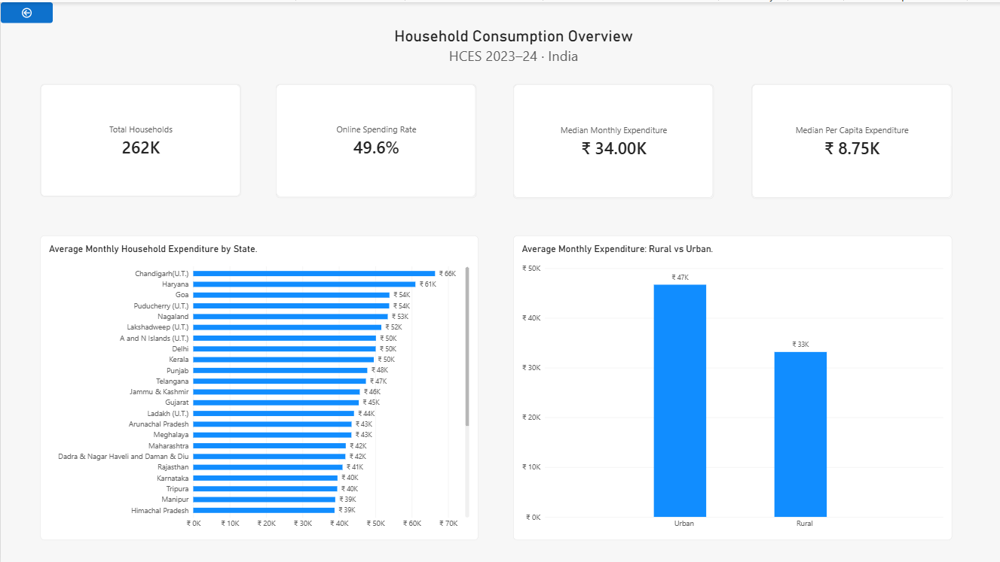
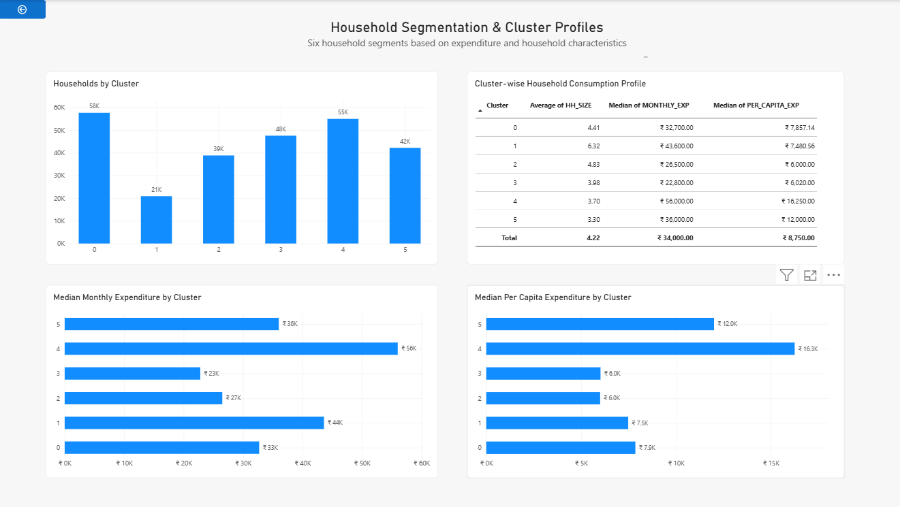
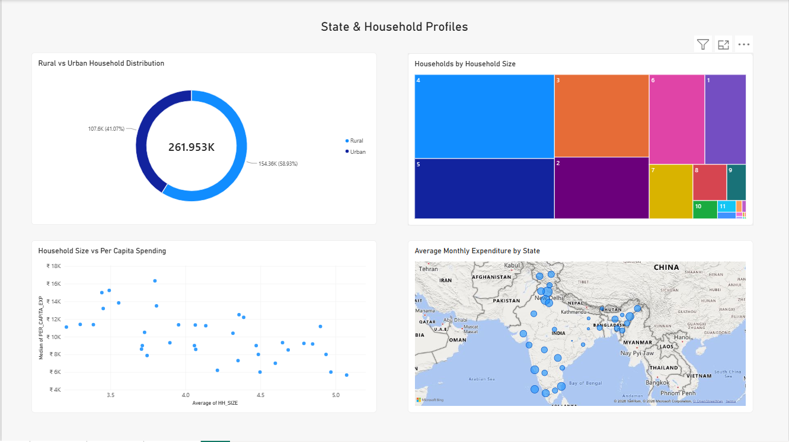
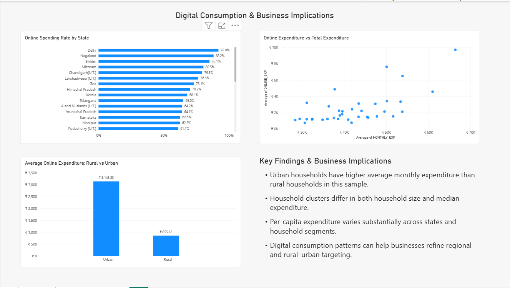

# Indian Household Consumption Analytics | HCES 2023–24

An exploratory data analytics and household segmentation project examining consumption expenditure, regional disparities, household characteristics, and digital spending patterns across India using the Household Consumption Expenditure Survey (HCES) 2023–24.

## Project Overview

This project analyses 261,953 household records using Python and Power BI to understand how household size, location, and regional characteristics relate to consumption expenditure and online spending behaviour. It combines data preparation, expenditure analysis, household clustering, and interactive visualisation across a four-page Power BI dashboard.

## Problem Statement

How do household size, location, and regional characteristics relate to consumption expenditure and digital spending patterns across India?

The analysis addresses four key questions

- How does monthly household expenditure vary across states and between rural and urban households?
- How do household segments differ in size and consumption expenditure?
- What relationship exists between household size and per-capita expenditure?
- How does online expenditure vary across states and between rural and urban households?

## Key Findings and Insights

### 1.  **Household Size and Per-Capita Spending**

  Cluster 1 has the largest average household size at 6.32 members, while Cluster 4 averages 3.70 members and records the highest median per-capita expenditure of ₹16,250. This highlights the importance of considering household composition when analysing individual spending patterns.

### 2. **Differences in Household Consumption**

  Cluster 4 records the highest median monthly household expenditure at ₹56,000, whereas Cluster 3 records the lowest at ₹22,800. The results reveal substantial differences in consumption levels across the six household segments.

### 3. **Rural–Urban Digital Spending Gap**

  Average online expenditure among urban households is ₹3,143.83, compared with ₹855.12 among rural households. Urban online expenditure is approximately 3.7 times higher, highlighting a substantial difference in online purchasing expenditure between the two sectors.

### 4. **Regional Variation in Digital Spending**

  Delhi records the highest displayed online spending participation rate at 92%, followed by Nagaland at 88.2% and Sikkim at 85.1%. These differences highlight the uneven distribution of online spending participation across states.

### 5. **Geographic Differences in Household Expenditure**

  Chandigarh (U.T.) and Haryana record the highest average monthly household expenditure among the states displayed, at approximately ₹66,000 and ₹61,000, respectively. This demonstrates the importance of regional analysis when examining household consumption patterns.

### 6. **Relationship Between Household Size and Per-Capita Expenditure**

  The state-level analysis shows a negative correlation between average household size and median per-capita expenditure. However, this relationship is descriptive and does not establish that larger households cause lower per-capita spending.

## Power BI Dashboard

The interactive dashboard is organised into four pages covering overall consumption patterns, household segmentation, geographic profiles, and digital spending behaviour.

### Page 1 — Household Consumption Overview

Summarises household expenditure indicators, state-wise consumption patterns, and differences between rural and urban households.

### Page 2 — Household Segmentation & Cluster Profiles

Examines the distribution of households across six clusters and compares household size, median monthly expenditure, and median per-capita expenditure across segments.

### Page 3 — State & Household Profiles

Explores rural–urban household distribution, household-size composition, the relationship between household size and per-capita expenditure, and geographic spending patterns.

### Page 4 — Digital Consumption & Business Implications

Analyses online spending participation across states, the relationship between online and total expenditure, and rural–urban differences in average online expenditure.

## Methodology

1. **Data Preparation** — Loaded and examined HCES 2023–24 household survey files.
2. **Data Cleaning** — Handled missing values and prepared household-level variables for analysis.
3. **Expenditure Calculation** — Applied the survey's household expenditure adjustment approach to construct comparable monthly expenditure measures.
4. **Feature Engineering** — Derived monthly household expenditure, per-capita expenditure, sector labels, and other analytical variables.
5. **Household Segmentation** — Applied clustering to develop six exploratory household profiles based on selected household and expenditure characteristics.
6. **Exploratory Data Analysis** — Compared expenditure patterns across states, rural and urban sectors, household sizes, and clusters.
7. **Dashboard Development** — Built an interactive four-page Power BI dashboard to communicate the findings.

## Technology Stack

**Python, Pandas, Scikit-learn, Power BI, DAX, and Power Query.**

Python and Pandas were used for data preparation, transformation, and analysis. Scikit-learn was used for household clustering and model evaluation. Power BI, DAX, and Power Query were used to build the interactive dashboard, transform data, and create analytical measures.

## Data Source

**Household Consumption Expenditure Survey (HCES) 2023–24**

The project uses household survey data published by India's National Statistics Office (NSO), Ministry of Statistics and Programme Implementation (MoSPI).

Official source — [Ministry of Statistics and Programme Implementation](https://www.mospi.gov.in/)

The data includes household characteristics, consumption expenditure, location, and online expenditure variables used in the analysis. Refer to the official survey documentation for definitions, sampling details, and expenditure estimation procedures.

## Business Implications

- **Consumer Segmentation**

  Combining household size, monthly expenditure, and per-capita expenditure can help businesses identify consumer groups with different spending patterns and household needs.

- **Regional Market Planning**

  State-level expenditure differences can inform regional market analysis and market prioritisation.

- **Digital Channel Strategy**

  Variation in online spending participation can help businesses assess regional differences in digital purchasing behaviour.

- **Rural–Urban Market Strategy**

  Differences in online expenditure can guide further investigation into purchasing channels, product availability, and fulfilment requirements across rural and urban markets.

## Limitations

- The analysis is descriptive and does not establish causation.
- The clustering silhouette score of approximately 0.118 indicates weak separation between clusters. The six clusters should therefore be interpreted as exploratory profiles rather than clearly distinct consumer types.
- State-level aggregates can conceal substantial variation between individual households.
- Online spending participation and average online expenditure measure different aspects of digital consumption and should not be interpreted interchangeably.
- Findings should be interpreted within the scope and methodology of the HCES 2023–24 survey.

## Conclusion

This project demonstrates an end-to-end household consumption analytics workflow, from survey-data preparation and expenditure analysis to household segmentation and interactive visualisation. By combining Python-based analysis with Power BI reporting, it examines regional consumption differences, household expenditure profiles, and digital spending patterns across India.

The resulting dashboard provides a structured foundation for further analysis of household consumption behaviour and data-driven market planning.
